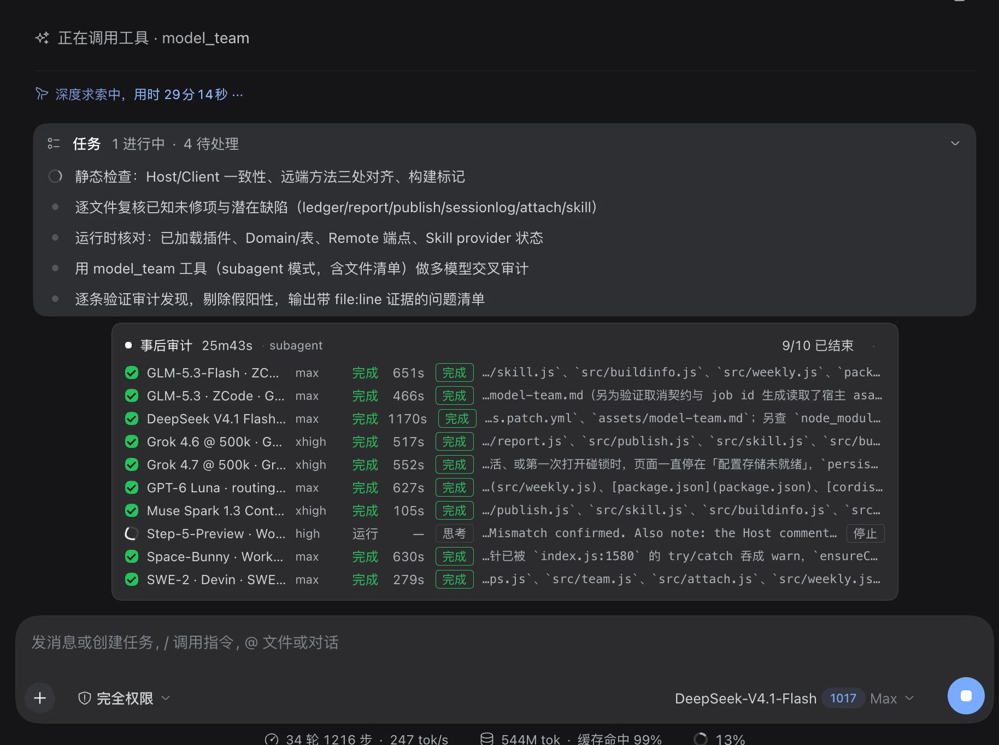
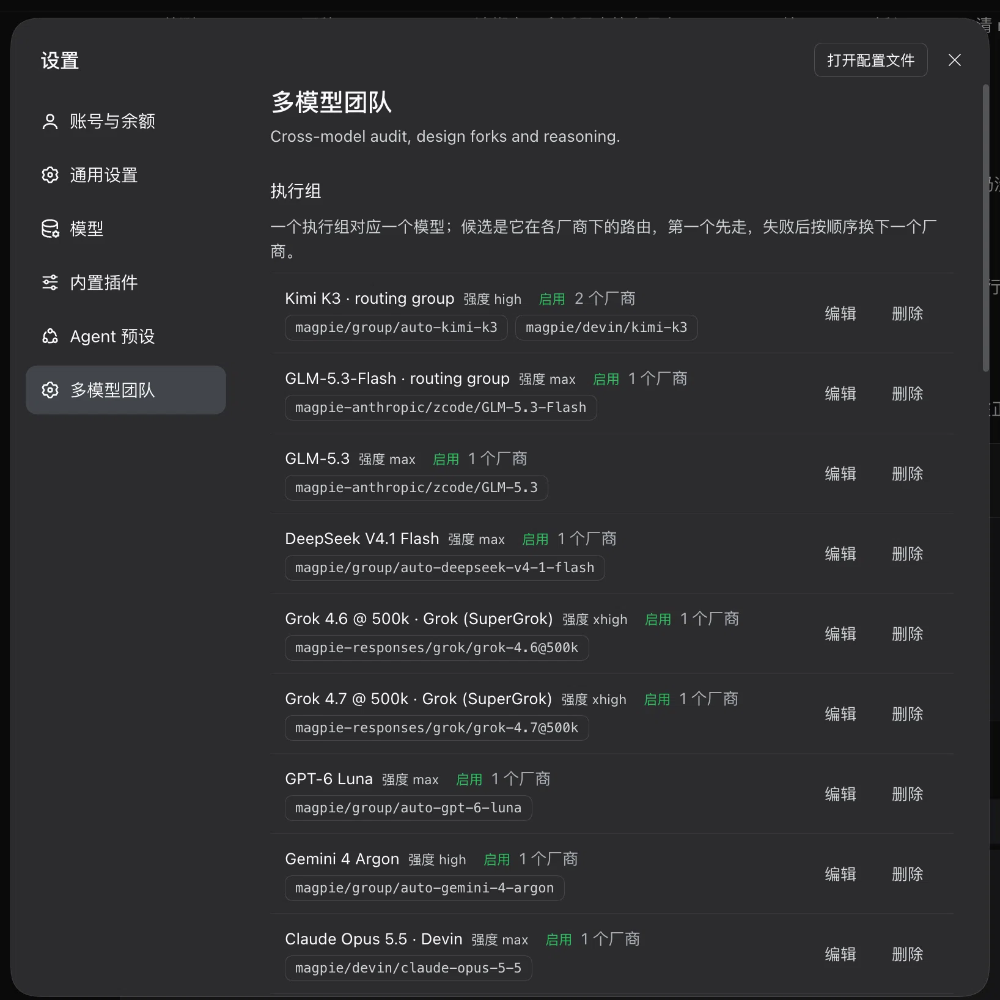

# 多模型团队 · DeepSeek Harness 插件

用同一份任务包并发询问多家模型，做事后审计、设计分叉与专责推理。
每家模型在会话输入框上方占一行，实时显示「思考 / 工具 / 回答 / 完成」；
打开「保存数据」后，结果进 SQLite 账本，可出周报与静态报告。

插件同时注册 `model-team` 技能：安装后 DSH 自动发现它，任务命中多模型审计/分叉/推理时，
模型会按技能里的口径调用 `model_team`，不需要手动加载，也不用再往 `~/.dsh/skills` 放文件。

除了 DSH 已注册模型，还可以通过 **CLI harness 协议**接入 pi / opencode 等 CLI 的无头模式；
CLI 模型与 DSH 路由可以混在同一个执行组里做主备回落。



## 它解决什么问题

- **一次问 N 家，互不影响**：每家一次独立调用（或一个独立子代理），失败的只落自己那一行。
- **审计能看代码**：`files` 指定本次涉及的文件；`llm` 模式把正文带行号附进提示词，
  `subagent` 模式只给清单，让子代理自己 `read` / `grep` / `glob`。
- **执行组带主备**：一个组 = 同一逻辑模型的多个厂商路由，主力失败自动换厂商，而不是整组失败。
- **结果可复查**：账本、每跳会话 JSON、周报、自包含 HTML 报告，都是本地文件。
- **进度可见**：逐模型一行，带阶段、耗时与最新输出；运行中可单家「停止」，整场可取消。
- **CLI harness 可接入**：pi / opencode 等 CLI 按一份协议定义接入（`src/harness/`），
  和 DSH 路由混排做回落；协议见 [docs/harness-protocol.md](docs/harness-protocol.md)。
- **技能随插件自动注册**：`model-team` 技能由插件启动时注册，装好就在 DSH 的技能目录里；
  任务命中时模型按技能说明自动调用 `model_team`。开发本仓库时，项目级 `.dsh/skills` 会自动覆盖内置版。

## 界面

### 执行进度窗

首图就是执行中的样子：标题行顺序是 **活动名 → 已用时 → 模式 → 进度**；每模型一行，依次是：
行首状态图标、模型名、思考强度、状态、耗时、阶段徽标、最新一段输出。
运行中的行右侧有「停止」；整场执行期间不允许关闭，结束后点 × 关闭，下次执行会自动重新打开。

### 设置 → 多模型团队



- **执行组**：按模型聚合厂商路由，候选顺序即回落顺序（可拖拽排序）。
- **活动绑定**：`audit` / `design` / `reason` 各自派哪些组上场；不选 = 全部启用组。
- **保存数据**：总开关，控制账本、会话日志、周报与报告；默认关。
- **周报与报告**：总结模型、报告目录、生成后自动上传。

## 安装

本包是内部包（`package.json` 的 `private: true`），以**本地目录**安装/链接进 DSH profile。
运行环境要求：

- DSH `0.2.1-rc.2`（本包依赖的版本；插件用 `node:sqlite`，需要 DSH 自带的 Node 24）；
- profile 启用 `storage-domain` 与 `storage-json`（配置域：执行组/绑定/偏好）；
- 需要进度窗时启用 `jobs`；需要 `mode=subagent` 时启用 `subagents`。

安装步骤：

1. 把本目录放进任意位置，用 `plugin_manager` 安装/启用
   （本地开发也可以目录链接的方式加入 profile 的 `dsh.profile.bundles`）。
2. 本包的 `cordis.patch.yml` 会由 bundle 机制合并，插入 `model-team` 这一行；
   `package.json` 的 `dsh.client` 会让浏览器半边自动发现 `client.js`。
3. 重载插件。工具列表里出现 `model_team` / `model_team_weekly` 即安装成功。

安装后可自检：

```
cordis_inspect_query(platform: "host", provider: "Tool", method: "listTools")
```

## 快速开始

```
model_team(
  packet: "# Task Packet：<切片名>\n\n## 目标\n找出本切片的缺陷\n\n## 入口\nindex.js / client.js",
  kind: "audit",
  mode: "subagent",
  files: ["index.js", "client.js", "src/ledger.js"],
  workspace: "/Users/me/project"
)
```

跑完返回 `models[]`：每家一行（`status` / `seconds` / `text` / `error` / `tried` / `logPath`）。
生成周报：

```
model_team_weekly(days: 7)
```

## 参数

| 参数 | 类型 | 说明 |
| --- | --- | --- |
| `packet` | string（必填） | 自包含任务包，1–3K token；被调模型看不到你的会话 |
| `kind` | `audit` \| `design` \| `reason` | 默认 `audit`；三种活动的开场约束不同 |
| `models` | string[] | 可选点名：`provider/model` 或 `provider/model@@effort`；CLI 模型写 `cli-pi/k3@@max`；省略 = 按绑定执行组跑 |
| `mode` | `llm` \| `subagent` | 默认 `llm`；要读仓库用 `subagent`；**CLI 条目忽略此参数**（工具能力由 harness 定义声明） |
| `files` | string[] | 本次涉及的文件（subagent 模式也接受目录）；相对路径要配 `workspace` |
| `workspace` | string | `files` 的解析基准，必须是绝对路径；**CLI 条目必填**（作为 CLI 的 cwd） |
| `max_depth` | integer | 仅 `subagent`：子代理的分包深度 |

语义要点：

- **点名 = 接管同款，不取消绑定**：`models` 命中某个执行组的任一候选，该组整组改走点名路由
  （主备链只留它）；没被命中的绑定组照常参与；绑定里没有的模型作为独立条目追加。
- **`files` 给什么**：`llm` 附正文（带行号，单文件 8 万字符 / 总量 24 万字符上限）；
  `subagent` 只附清单，正文由子代理自己读。
- **`@@`**：双 `@` 是思考强度分隔符；单 `@` 只做旧配置兼容（模型 id 自己可能带 `@`）。
- **什么都没配时**：没有执行组、没有绑定、静态名单也为空，默认跑**全部已注册模型**；
  配了组/绑定之后按配置走，解析不到会**响亮报错**，不会退化成跑全目录。

## 配置

### 执行组

一个组 = 同一个逻辑模型的多个厂商路由。第一个先走，失败后按顺序换下一个厂商。

- Kimi K3 · routing group：`magpie/group/auto-kimi-k3` → `magpie/devin/kimi-k3`
- GLM-5.3：`magpie-anthropic/zcode/GLM-5.3`

「停用」的组不参加默认执行；被绑定了也不上场。

### 活动绑定

`audit` / `design` / `reason` 各自绑定一组执行组 id。不绑定时退回全部启用组；
绑定的组全被删或全停用时，`runTeam` 直接报错并指出是「已不存在」还是「停用」，
不会悄悄改跑整个模型目录。删除执行组时会同步清理所有绑定里的该 id。

### 偏好

| 项 | 默认 | 说明 |
| --- | --- | --- |
| 保存数据 | 关 | 总开关：关着不写账本/会话日志，周报与报告明确报错 |
| 周报总结模型 | 空 | 一键周报用哪个模型做总结 |
| 报告目录 | `~/.model-team` | 报告写在其 `reports/` 下 |
| 自动上传 | 关 | 需同时满足：开关开 + 目录在 git 仓 + 仓有远端 |

配置落点：`$DSH_HOME/storages/model_team_config.json`（执行组 / 绑定 / 偏好）。

静态配置（`cordis.patch.yml`）仍可给这几项：

```yaml
- insert:
    - id: model-team
      name: '@vastplan/model-team'
      config:
        toolName: model_team
        models: []          # 默认名单；省略 = 按绑定/全部模型
        reportModel: ''     # 周报总结模型
        ledgerPath: ''      # 默认 $DSH_HOME/model-team/ledger.db
        runsRoot: ''        # 默认 $DSH_HOME/model-team/runs
```

## CLI Harness（可选）

除了 DSH 已注册模型，插件内置了 8 家 CLI harness 定义：
`agent` / `pi` / `zcode` / `opencode` / `qoder` / `devin` / `cline` / `grok`。
其余 CLI 可以在配置里按同一协议追加；定义是**纯数据**，不用改执行层。

各家命令、默认只读纪律与占位符见 [docs/harness-protocol.md](docs/harness-protocol.md)；
示例模型条目见 [docs/cli-models.example.json](docs/cli-models.example.json)。

配置示例（`cordis.patch.yml`）：

```yaml
- insert:
    - id: model-team
      name: '@vastplan/model-team'
      config:
        cliModels:
          - id: k3
            tool: pi
            provider: magpie
            model: group/auto-kimi-k3
            name: Kimi K3
            modelKey: kimi-k3
        # 新增 CLI（可选）：
        harnesses:
          - id: foo
            command: foo
            args: ["--print", "--output-format", "json"]
            model: { flag: "--model", format: "{model}" }
            thinking: { flag: "--thinking", default: high }
            prompt: { via: argv, separator: "--" }
            output: { parser: auto }
```

- 合成 provider 是 `cli-<harness>`：上面的条目得到 `cli-pi/k3`，点名写 `cli-pi/k3@@max`。
- `modelKey` 与 DSH 路由一致时，页面会把它们聚成同一个执行组，可做
  `magpie/group/auto-kimi-k3 → cli-pi/k3` 的主备回落。
- CLI 条目必须有绝对 `workspace`（作为 cwd）；`files` 只附清单，CLI 自己读。
- 默认只读：pi 排除 `edit/write`，opencode 用 `OPENCODE_PERMISSION` 拒绝 edit/write/bash/task，
  qoder/devin/grok 用 `disallowed-tools`，cline 默认 `-p` plan 档；凭证由各 CLI 自己的登录态管理，插件不存密钥。
- devin 用随包的 `scripts/devin_acp.mjs`；zcode 需要本机 ZCode 应用与 `~/.zcode/cli/config.json`。
- 这些是**静态配置**：改完要重载插件；设置页暂不编辑 CLI 定义。
- **没装/没配的 CLI 不会出现在厂商路由里**（可用性检查缓存 30s）；登录态要到调用时才会暴露。
- **CLI 模型要逐条声明**：插件不会自动读取 pi/opencode 自己的模型配置；在 pi 里加了 GLM-5.3，
  还要在 `cliModels` 里加一条（`tool: pi` + `model: auto/GLM-5.3`）才会出现在厂商路由里。
- 完整字段、占位符、argv 顺序、错误/取消语义见 [docs/harness-protocol.md](docs/harness-protocol.md)。

## 数据落盘

| 位置 | 内容 |
| --- | --- |
| `$DSH_HOME/model-team/ledger.db` | SQLite：`runs` / `calls` / `call_metric` / `reports` |
| `$DSH_HOME/model-team/runs/<场次ID>/` | `packet.txt`、`prompt.md`、每跳会话 JSON、`*.balance.json` |

- 账本主键是 `(run_id, call_id, slot)`：同一模型在两个执行组各跑一次不会互相覆盖。
- 会话日志文件名带模型 / 路由 / 强度 / 槽位（`<模型>.<路由-工具>.<强度>.<槽位>.0.json`），
  真撞名再加序号，不覆盖。
- 保留 90 天，生成周报时顺手清理（`reports` 一起清）。
- 总开关关着时**不写任何账本行或会话日志**、不建场次目录；
  `ledger.db` 文件本身会在插件启动时被打开（可能作为空库存在）。

## 周报与报告

- 工具：`model_team_weekly(days, model?)`。总结模型优先级：工具参数 > 设置页 > 静态配置 > 名单首项。
  总结失败只记 `summaryError`，聚合数据照常落库。
- 页面：设置 → 多模型团队 → 执行报告 →「生成并打开」/「打开最新」。
- 报告是自包含 HTML，落 `<报告目录>/reports/`；开启自动上传且目录满足条件时 commit+push
  （GitHub 仓会顺带给出 Pages 地址）。

## 进度窗与停止

- 挂在 `conversation.input.dock`，只显示本插件 `kind=team` 的 job。
- 顺序以开场 `roster` 控制行为准，结果以收尾 `final` 为准；job 输出环被截断也不会打乱顺序、
  不会丢掉已完成的行。
- 运行中可对单家点「停止」；停止失败会在标题行显示原因，不再「点了没反应」。
- 整场在跑时 × 禁用；结束后点 × 关闭，下次执行自动重新打开。
- 任务面板的「取消」会 abort 本场所有模型调用（producer 自己 abort，符合 DSH job 契约），
  被取消的场次按 `killed` 结算，不写账本。

## 内置技能

插件把 [`assets/model-team.md`](assets/model-team.md) 注册成 `model-team` 技能
（provider `vastplan-model-team`，bundled rank 600）。

- 装好插件，模型就能看到技能说明，不需要再往 `~/.dsh/skills` 放一份；
- 项目级 `.dsh/skills`（rank 100）/ 用户级（rank 400）里的同名技能会**压过**内置版。

**开发这个插件时**：本仓库自带的 [`.dsh/skills/model-team/SKILL.md`](.dsh/skills/model-team/SKILL.md)
会被 DSH 自动发现并优先采用（项目级 rank 100 压过内置的 600）——你在这个工作区让 agent
做多模型审计，它会直接按这份技能调用 `model_team`，不需要手动加载。两份内容必须同步，
否则内置版与项目版会分叉（`cp assets/model-team.md .dsh/skills/model-team/SKILL.md`）。

技能里写清了调用参数、Task Packet 写法、点名语义、账本口径与当前限制。

## 开发与重载

- **Host 半**（`index.js` / `src/*.js`）：改完在插件面板关闭再打开。
  启动时会打印 Host 半是否落后于磁盘源码；落后时工具结果与页面顶部也会提示。
- **Client 半**（`client.js`）：改完把顶部 `BUILD` 升一版，重载插件并**刷新页面**；
  浏览器控制台会打印 `model-team: client build <BUILD>`。
- 语法检查：

  ```bash
  for f in index.js client.js typert.js src/*.js src/harness/*.js; do node --check "$f"; done
  ```

- Remote 三处清单（Host 标记 / `typert.js` / `client.js`）必须一致，
  插件启动时会自动跑一次；也可以手动：

  ```bash
  node --input-type=module -e "import fs from 'node:fs'; const m = await import('./index.js'); \
    console.log(m.checkRemoteConsistency({ typert: fs.readFileSync('./typert.js','utf8'), \
    client: fs.readFileSync('./client.js','utf8') }))"
  ```

- CLI harness 协议测试（用假 CLI，不需要真实 pi/opencode）：

  ```bash
  node --test scripts/harness.test.mjs
  ```

## 当前限制

- `mode=subagent` 的子代理 **token 用量拿不到**（host 的 `activation.result` 没有 usage），
  账本记 0、报告显示 `—`；这不代表模型没烧 token。
- 执行组只把**最终生效的那一跳**写账本；失败的前几跳只留在 `tried` 里，不进周报。
- 并发闸门默认 12（subagent 模式），受宿主 `maxActiveSubagents` 约束；
  设置页里的 `concurrency` 偏好尚未接入执行路径。
- 报告自动上传会推送整条分支（不是只推报告那一个 commit）；首次使用前先确认仓库状态。
- 周报与报告依赖「保存数据」总开关；关着时明确报错，不生成空报告。
- CLI harness 的 token 用量取决于该 CLI 的事件流；拿不到时按未采集记 0（与 subagent 同口径）；
  CLI 未安装/未登录会在该行失败，并带上 stderr 尾部。

## 目录结构

```
model-team/
├── index.js              # Host 半：工具、runTeam、Remote 服务、技能注册
├── client.js             # Client 半：设置页、执行组编辑、进度窗
├── typert.js             # Remote 描述符（与 index.js / client.js 三处对齐）
├── assets/model-team.md  # 内置技能正文
├── src/
│   ├── ledger.js         # SQLite 账本：schema v3、迁移、聚合、prune
│   ├── sessionlog.js     # 场次目录、会话日志、调度留痕
│   ├── report.js         # 自包含 HTML 报告
│   ├── publish.js        # 报告目录的 git 自动上传
│   ├── groups.js         # 配置域：执行组 / 偏好 / 绑定
│   ├── team.js           # 名单解析与 @@ 分隔符
│   ├── attach.js         # llm 附正文 / subagent 附清单
│   ├── skill.js          # 内置技能 provider
│   ├── buildinfo.js      # Host 半新鲜度自检
│   ├── weekly.js         # 周报提示词与事实文本
│   └── harness/          # CLI harness：protocol / defs / exec / parse / catalog
├── docs/
│   ├── images/           # README 截图
│   └── harness-protocol.md
├── locale/               # 插件元数据（标题/描述）
├── cordis.patch.yml      # bundle 插入行
└── icon.svg
```

## 许可

[MIT License](LICENSE) © 2026 model-team contributors。
